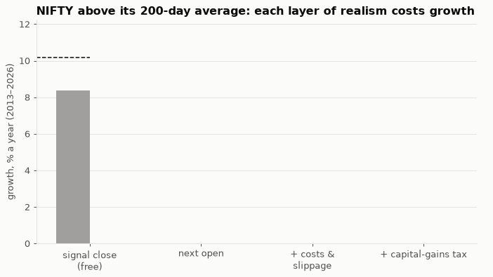

# Moving-Average Backtest

[](https://github.com/Dhirajdas18/moving-average-backtest/actions/workflows/ci.yml)
[](https://dhirajdas18.github.io/moving-average-backtest/)

A backtester for moving-average trading rules on NSE stocks (RELIANCE, HDFCBANK, INFY, TCS, ITC) and the
NIFTY 50, built to give the answer you would actually have got: trades fill at the next open, every order
pays Indian charges and slippage, and capital-gains tax is settled each financial year.

**Live dashboard: [dhirajdas18.github.io/moving-average-backtest](https://dhirajdas18.github.io/moving-average-backtest/)**,
rebuilt weekly from fresh data by GitHub Actions.

## Features

- [x] Rupee-accurate engine: next-open fills, Zerodha delivery charges, slippage, cash interest, STCG/LTCG
  tax with loss set-off and carry-forward, after-tax liquidation value
- [ ] SMA vs EMA; price filter vs fast/slow crossover
- [ ] Trade statistics: win rate, payoff, expectancy, exposure, tax drag
- [ ] Parameter sweep, deflated Sharpe ratio, probability of backtest overfitting
- [ ] Walk-forward optimisation
- [ ] Trend filter vs a same-exposure fixed mix
- [ ] Survivorship bias

## Findings

### 1. A realistic backtest takes 1.7–2.3 points a year off a 200-day rule, two to three times what buy and hold pays

<table><tr>
<td><a href="docs/img/engine_waterfall.png"><picture><source media="(prefers-reduced-motion: reduce)" srcset="docs/img/engine_waterfall.png"></picture></a></td>
<td><a href="docs/img/engine_drag.png"><picture><source media="(prefers-reduced-motion: reduce)" srcset="docs/img/engine_drag.png"></picture></a></td>
</tr></table>

The rule holds while the close is above its 200-day simple moving average and sits in cash (earning
6.5%) otherwise. It traded 48–72 times over 2013–2026, about 4–5 round trips a year.

- **NIFTY:** 8.4% a year in the common naive backtest (trade at the signal's own close, no costs, no tax),
  6.8% after next-open fills, costs and tax. Buy and hold kept 10.2% after the same costs and tax.
- **Costs** took 1.2–1.8 points a year from the rule on every series, and **tax** another 0.2–1.0. Buy and
  hold lost 0.6–1.0 points in total, mostly the long-term tax on selling at the end.
- **Filling at the next open instead of the signal close** moved results by −1.2 to +0.4 points, in both
  directions (HDFCBANK −1.2, TCS +0.4). The overnight gap is noise for a slow rule, but it is real money
  for a fast one.
- On these six series, the 200-day rule kept less than buy and hold on every one. Whether that is the
  rule or just these years is the subject of later sections.

## Assumptions

Capital ₹10 lakh. Zerodha delivery charges as of Nov 2026 ([zerodha.com/charges](https://zerodha.com/charges)):
STT 0.1% each side, stamp duty 0.015% on buys, NSE 0.00322%, SEBI 0.0001%, GST 18% on fees, ₹16 DP charge
per sell, plus 0.05% slippage each side. Tax with today's rules for every year: 20% short-term, 12.5%
long-term above ₹1.25 lakh a year, 4% cess; STT is not deductible; losses set off and carried forward.
Fractional shares, dividends reinvested, NIFTY traded as if it were an index fund. Not investment or tax
advice.

## Quick start

```bash
uv sync
uv run python scripts/fetch_data.py          # Yahoo Finance -> data/prices.parquet
uv run mab run --symbol NIFTY --window 200   # one rule, after costs and tax
uv run mab report engine                     # charts -> out/, numbers printed
uv run python scripts/build_site.py          # dashboard -> site/index.html
uv run pytest
```

## Design

- `src/mab/engine.py`: the backtest loop, in rupees, one long-or-flat position.
- `src/mab/costs.py`, `src/mab/tax.py`: charges per order; Indian capital-gains tax per financial year.
- `src/mab/signals.py`: moving averages and the rules built on them.
- `src/mab/reports.py`: README findings, reproducible with `mab report <topic>`.
- `src/mab/site.py`: the dashboard, one static Plotly page; no server, no committed data.

MIT licence.
