# Moving-Average Backtest

[](https://github.com/Dhirajdas18/moving-average-backtest/actions/workflows/ci.yml)
[](https://dhirajdas18.github.io/moving-average-backtest/)

A backtester for moving-average trading rules on NSE stocks (RELIANCE, HDFCBANK, INFY, TCS, ITC) and the
NIFTY 50, built to give the answer you would actually have got: trades fill at the next open, every order
pays Indian charges and slippage, and capital-gains tax is settled each financial year.

**Live dashboard: [dhirajdas18.github.io/moving-average-backtest](https://dhirajdas18.github.io/moving-average-backtest/)**,
rebuilt weekly from fresh data by GitHub Actions.

## Features

- [x] Rupee-accurate engine: next-open fills, fractional target weights with a rebalancing band, FIFO tax
  lots, Zerodha delivery charges, slippage, cash interest, STCG/LTCG tax with loss set-off and
  carry-forward, after-tax liquidation value
- [x] SMA vs EMA; price filter vs fast/slow crossover
- [x] Trade statistics: win rate, payoff, break-even win rate, holding periods, profit concentration
- [x] Parameter sweep, deflated Sharpe ratio, probability of backtest overfitting (interactive heatmap)
- [x] Walk-forward optimisation
- [x] Trend filter vs a same-exposure fixed mix (FIFO tax lots, rebalancing band)
- [ ] Survivorship bias

## Findings

### 1. A realistic backtest takes 1.7–2.3 points a year off a 200-day rule, two to three times what buy and hold pays

<table><tr>
<td><a href="docs/img/engine_waterfall.png"><picture><source media="(prefers-reduced-motion: reduce)" srcset="docs/img/engine_waterfall.png"></picture></a></td>
<td><a href="docs/img/engine_drag.png"><picture><source media="(prefers-reduced-motion: reduce)" srcset="docs/img/engine_drag.png">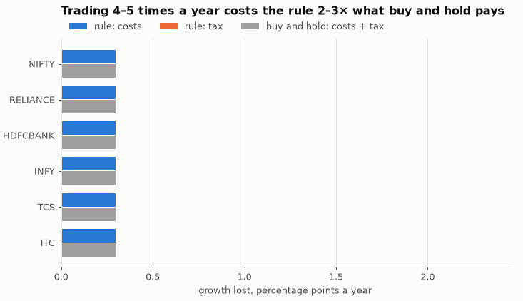</picture></a></td>
</tr></table>

The rule holds while the close is above its 200-day simple moving average and sits in cash (earning
6.5%) otherwise. It traded 48–72 times over 2013–2026, about 4–5 round trips a year.

- **NIFTY:** 8.4% a year in the common naive backtest (trade at the signal's own close, no costs, no tax),
  6.8% after next-open fills, costs and tax. Buy and hold kept 10.2% after the same costs and tax.
- **Costs** took 1.2–1.8 points a year from the rule on every series, and **tax** another 0.2–1.0. Buy and
  hold lost 0.6–1.0 points in total, mostly the long-term tax on selling at the end.
- **Filling at the next open instead of the signal close** moved results by −1.2 to +0.4 points, in both
  directions (HDFCBANK −1.2, TCS +0.4). The overnight gap is noise for a slow rule, but it is real money
  for a fast one.
- On these six series, the 200-day rule kept less than buy and hold on every one. Whether that is the
  rule or just these years is the subject of later sections.

### 2. Filters whipsaw, crossovers lag, and buy and hold beat both on five of six series

<table><tr>
<td><a href="docs/img/rules_2020.png"><picture><source media="(prefers-reduced-motion: reduce)" srcset="docs/img/rules_2020.png">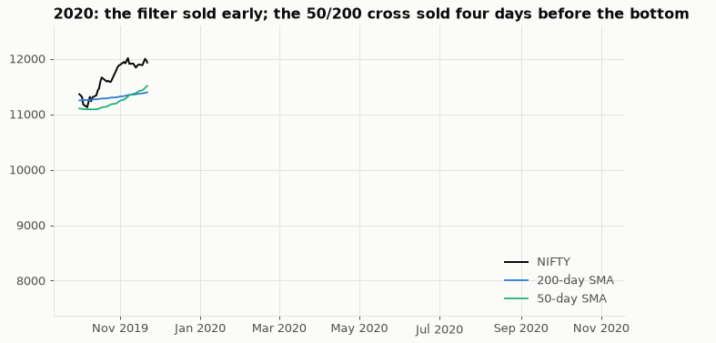</picture></a></td>
<td><a href="docs/img/rules_whipsaw.png"><picture><source media="(prefers-reduced-motion: reduce)" srcset="docs/img/rules_whipsaw.png">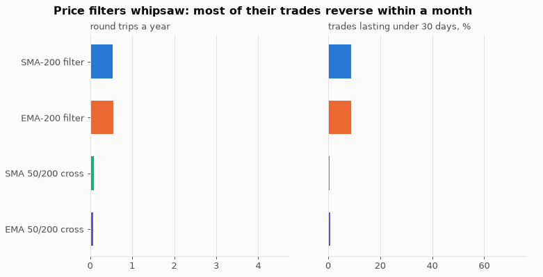</picture></a></td>
</tr></table>

Four textbook rules at standard settings (not tuned, so no parameter was chosen with hindsight): a price
filter (hold while the close is above its 200-day average) and a 50/200 crossover (hold while the 50-day
average is above the 200-day), each with a simple (SMA) or exponential (EMA) average.

- **Filters whipsaw.** They made 4.2–4.3 round trips a year, and 72–73% of their trades ended within 30 days,
  mostly at a small loss (win rate 22–23%). Each false signal pays costs and often short-term tax.
- **Crossovers lag.** They traded 0.6–0.7 times a year with few whipsaws, but exit late. In 2020 the SMA
  50/200 cross sold NIFTY on 19 Mar, 33% below the peak and four days before the bottom, and bought back
  on 21 Aug, 49% above the low. The SMA filter sold on 26 Feb (6% below the peak) but also bought back
  late (17 Jul, +43% from the low).
- **An EMA and an SMA of the same length have the same average lag** ((N−1)/2 days); the EMA just reacts to
  a new move sooner. The EMA version kept more on 6 of 6 series for the crossover and 4 of 6 for the filter.

<a href="docs/img/rules_cagr.png"><picture><source media="(prefers-reduced-motion: reduce)" srcset="docs/img/rules_cagr.png"></picture></a>

- **No rule style won consistently.** Crossovers beat filters on only 3 of 6 series (SMA) and 4 of 6 (EMA);
  the higher averages come from a few series.
- **Buy and hold kept the most on 5 of 6 series.** The exception was ITC, where the EMA cross kept 8.0% a
  year against 6.3%. The rules did cut the worst drawdown (33–38% on average, against 47%), which section
  6 tests against a fair same-exposure benchmark.

### 3. The 200-day filter is right a quarter of the time, and three trades carry all of its profit

<table><tr>
<td><a href="docs/img/trades_hist.png"><picture><source media="(prefers-reduced-motion: reduce)" srcset="docs/img/trades_hist.png">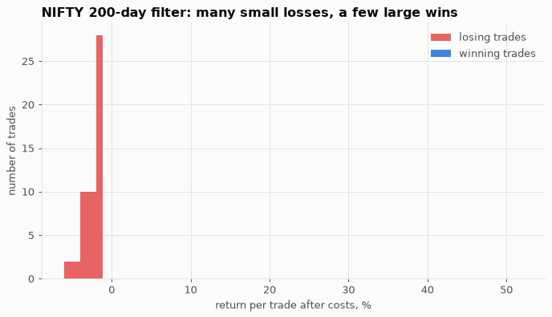</picture></a></td>
<td><a href="docs/img/trades_concentration.png"><picture><source media="(prefers-reduced-motion: reduce)" srcset="docs/img/trades_concentration.png">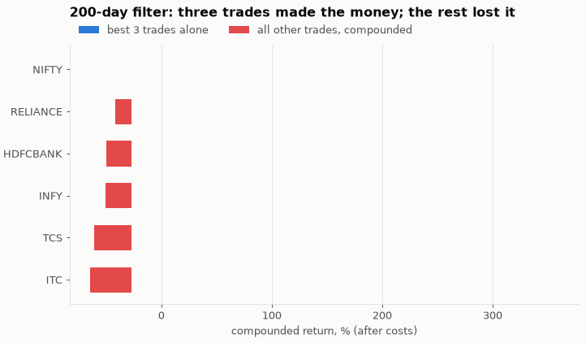</picture></a></td>
</tr></table>

- **Rarely right, right big.** The 200-day filter won only 14–26% of its trades, but its average win was
  5–9× its average loss (NIFTY: +11.1% vs −1.6%). At that payoff it breaks even with a 10–17% win rate, so a
  low win rate is not by itself a flaw.
- **Losers are cut fast, winners run.** The median losing trade lasted 3–6 days; the median winner 148–188
  days (TCS: 48).
- **Three trades carry everything.** On every series, the three best trades alone compounded to +165% to
  +303%, and all the other 45–69 trades together *lost* 25% to 65%. Measured in log returns, so trade size
  doesn't matter. Miss one big trend (a late order, a day of hesitation, an outage) and most of the result
  is gone, which is why such rules are hard to follow in practice.
- **The 50/200 cross** trades 8–11 times in 14 years and wins more often (27–89%), but with so few trades
  its statistics rest on a handful of outcomes.

### 4. The best of 40 parameter pairs beats buy and hold in hindsight, and that proves nothing

<table><tr>
<td><a href="docs/img/sweep_heatmap.png"><picture><source media="(prefers-reduced-motion: reduce)" srcset="docs/img/sweep_heatmap.png">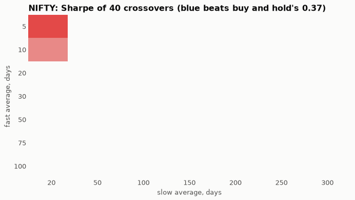</picture></a></td>
<td><a href="docs/img/sweep_overfit.png"><picture><source media="(prefers-reduced-motion: reduce)" srcset="docs/img/sweep_overfit.png">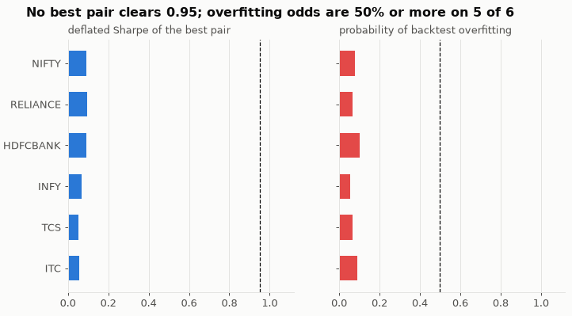</picture></a></td>
</tr></table>

Every fast/slow SMA crossover with fast in 5–100 days and slow in 20–300 days (40 pairs), after costs,
Sharpe ratio against a 6.5% risk-free rate. On the [dashboard](https://dhirajdas18.github.io/moving-average-backtest/#parameter-sweep),
click any cell to see that pair's equity curve.

- **The "best" pair changes with the stock:** 20/50 (NIFTY), 100/300, 30/200, 75/300, 10/250 and 50/250.
  There is no universal setting, only a different lucky one per series.
- **In hindsight the best pair looks good:** it beat buy and hold's Sharpe on 4 of 6 series (NIFTY 0.52 vs
  0.37). The *median* pair beat buy and hold on only 1 of 6.
- **The deflated Sharpe ratio** (Bailey & López de Prado, 2014) asks how likely the best result is to be real
  once you account for having tried 40 variants and for fat tails. It came out at 0.44–0.77 against the
  usual 0.95 bar. None of the six "winners" is convincing.
- **The probability of backtest overfitting** (Bailey et al., 2017) splits the history into halves every
  possible way (252 splits) and asks how often the in-sample winner falls to the bottom half out of sample.
  It was 0.44–0.84, and 0.5 or higher on 5 of 6 series, so picking the best pair was no better than picking
  at random. One sample's PBO is itself noisy (it ranges 0.1–0.95 on pure noise in tests), so the
  consistent pattern across series matters more than any single value.
- The 40 pairs overlap heavily (neighbours behave alike), so they are fewer than 40 independent tries, and
  counting all 40 sets the bar a little too high. The extreme opposite, no allowance at all as if only one
  pair had been tried, still leaves only NIFTY's best pair above 0.95 (0.97; the others 0.84–0.94). Any
  realistic allowance for the search pulls it below.

### 5. Choosing the best pair as you go kept the least of all

<table><tr>
<td><a href="docs/img/wf_nifty.png"><picture><source media="(prefers-reduced-motion: reduce)" srcset="docs/img/wf_nifty.png">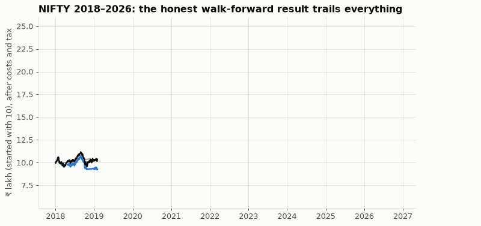</picture></a></td>
<td><a href="docs/img/wf_decay.png"><picture><source media="(prefers-reduced-motion: reduce)" srcset="docs/img/wf_decay.png">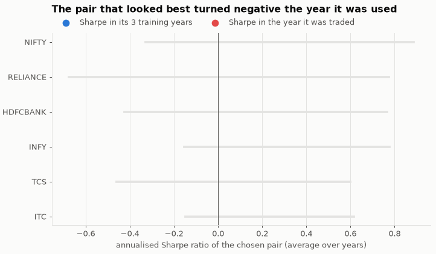</picture></a></td>
</tr></table>

Walk-forward optimisation is the honest version of "use the best setting": each January, the crossover pair
with the best Sharpe over the previous three years is chosen and traded for that year, then the process
repeats. Every approach below is measured over the same test years, 2018–2026, after costs and tax.

- **Walk-forward kept −0.6% to +4.9% a year.** It was beaten on every series by the textbook 50/200 cross
  (3.7–10.0%), by buy and hold (5.4–13.6%), and by the best pair chosen with hindsight (5.8–13.6%), which
  no one could actually have traded.
- **The chosen pair stopped working the moment it was chosen.** Its Sharpe averaged 0.6–0.9 over its three
  training years and −0.15 to −0.54 in the year it was traded, on every series. In its trading year it
  ranked, on average, between the 26th and 44th percentile of all 40 pairs: below the median on all six, so
  picking last period's winner was worse than picking at random. This is section 4's overfitting
  probability seen year by year.
- **The pick kept changing:** six to eight switches in eight years (NIFTY: 30/150, 5/50, 75/250, 20/50,
  20/50, 5/50, 50/100, 50/100, 20/50).
- **Five training years instead of three** gave the same picture: walk-forward below buy and hold on 6 of 6.

<a href="docs/img/wf_cagr.png"><picture><source media="(prefers-reduced-motion: reduce)" srcset="docs/img/wf_cagr.png">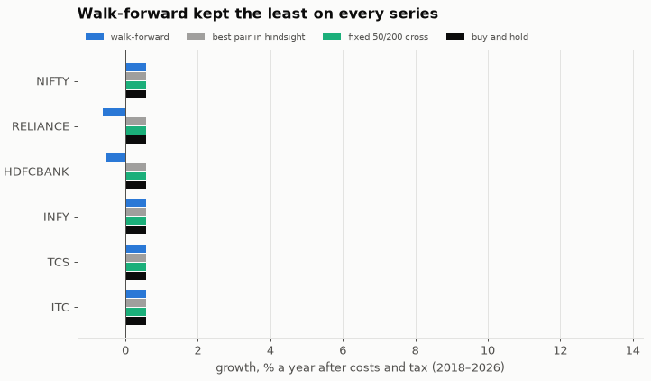</picture></a>

### 6. As risk control, a trend filter lost to simply holding less

<table><tr>
<td><a href="docs/img/overlay_nifty.png"><picture><source media="(prefers-reduced-motion: reduce)" srcset="docs/img/overlay_nifty.png">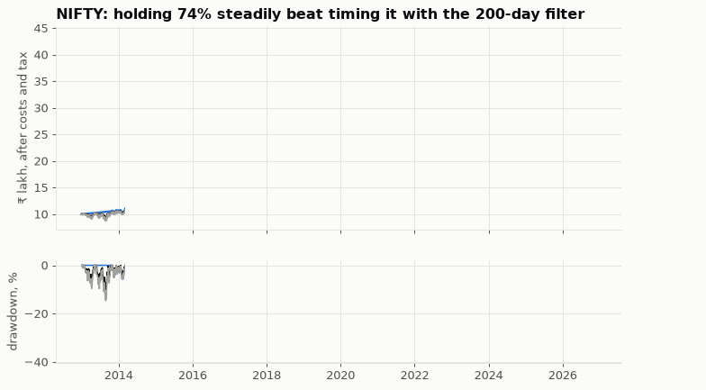</picture></a></td>
<td><a href="docs/img/overlay_compare.png"><picture><source media="(prefers-reduced-motion: reduce)" srcset="docs/img/overlay_compare.png">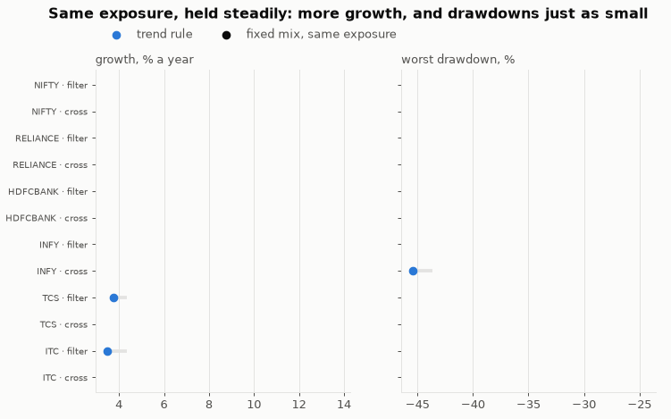</picture></a></td>
</tr></table>

Section 2 found the rules cut the worst drawdown (33–38% against 47% for buy and hold). But they were only
invested 57–80% of the time, and holding less stock lowers risk by itself. The fair test is a fixed mix
holding the rule's average exposure steadily (rebalanced when it drifts 5%, with FIFO tax lots), after the
same costs and tax, so any difference comes from timing alone. Two rules × six series = 12 cases.

- **Growth:** the fixed mix kept more in 11 of 12 cases (NIFTY: 9.7% a year at a steady 74% against 6.8% for
  the 200-day filter). The one exception was ITC's EMA 50/200 cross.
- **Risk:** the rule had the smaller worst drawdown in only 6 of 12 cases, a coin flip, and the better worst
  calendar year in 2 of 12. Whipsaw years (2015–16, 2018) hurt the rules more than steady holding did.
- **Sharpe ratio:** better for the rule in 2 of 12 cases.
- On NIFTY the filter spent years in shallow drawdowns (2015–17, 2022–23) while the steady mix recovered.
  The drawdown benefit seen earlier came from holding less, not from the timing. This matches what a
  volatility-target overlay showed in the
  [returns-volatility study](https://github.com/Dhirajdas18/returns-volatility-dashboard).

## Assumptions

Capital ₹10 lakh. Zerodha delivery charges as of Nov 2026 ([zerodha.com/charges](https://zerodha.com/charges)):
STT 0.1% each side, stamp duty 0.015% on buys, NSE 0.00322%, SEBI 0.0001%, GST 18% on fees, ₹16 DP charge
per sell, plus 0.05% slippage each side. Tax with today's rules for every year: 20% short-term, 12.5%
long-term above ₹1.25 lakh a year, 4% cess; STT is not deductible; losses set off and carried forward.
Fractional shares, dividends reinvested, NIFTY traded as if it were an index fund. Not investment or tax
advice.

## Quick start

```bash
uv sync
uv run python scripts/fetch_data.py          # Yahoo Finance -> data/prices.parquet
uv run mab run --symbol NIFTY --window 200   # one rule, after costs and tax
uv run mab report engine                     # also: rules trades sweep walkforward overlay
uv run python scripts/build_site.py          # dashboard -> site/index.html
uv run pytest
```

## Design

- `src/mab/engine.py`: the backtest loop in rupees: target weights, rebalancing band, FIFO tax lots.
- `src/mab/costs.py`, `src/mab/tax.py`: charges per order; Indian capital-gains tax per financial year.
- `src/mab/signals.py`: moving averages and the rules built on them.
- `src/mab/stats.py`: trade statistics and profit concentration.
- `src/mab/walkforward.py`: yearly re-selection on past data only (tested for look-ahead).
- `src/mab/sweep.py`, `src/mab/overfit.py`: parameter grids; deflated Sharpe ratio and PBO (CSCV), tested on
  pure-noise and real-edge data.
- `src/mab/reports.py`: README findings, reproducible with `mab report <topic>`.
- `src/mab/site.py`: the dashboard, one static Plotly page; no server, no committed data.

MIT licence.
